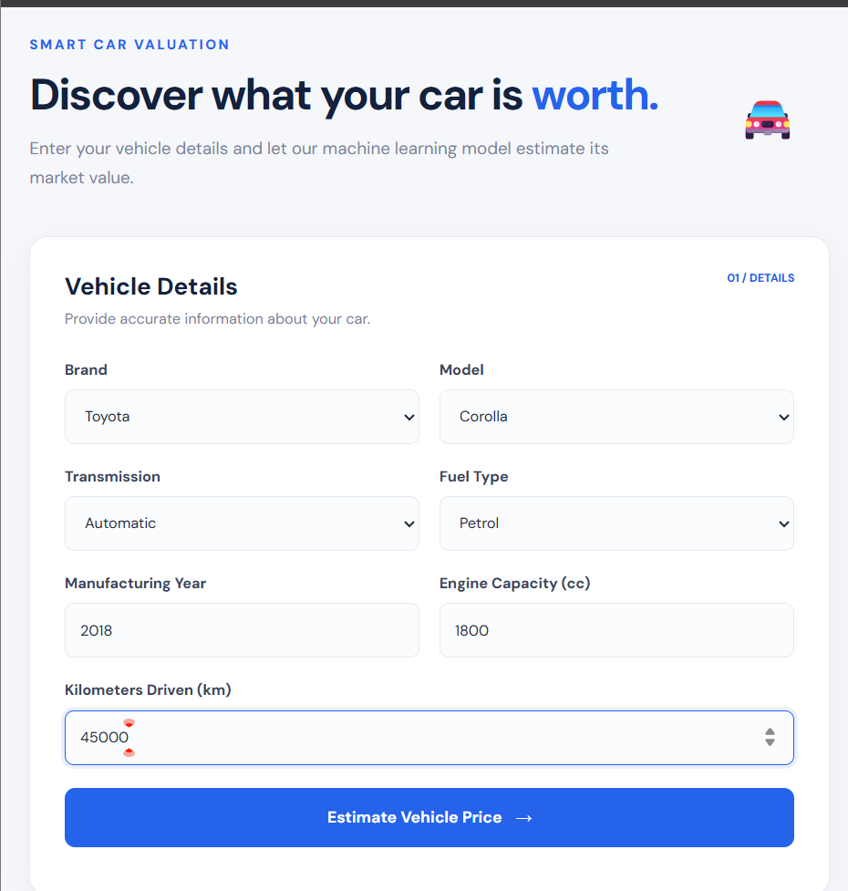
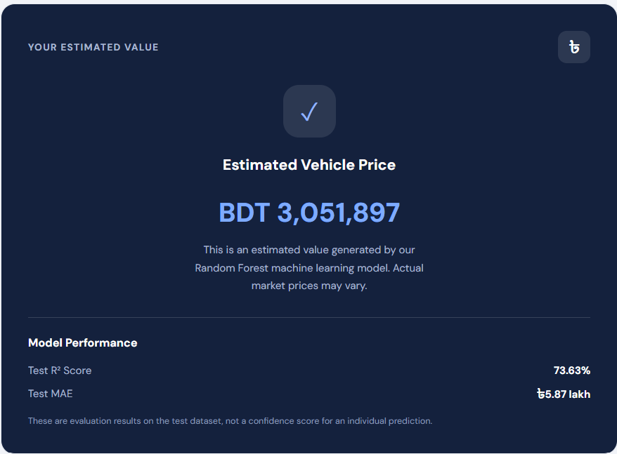

# Used Vehicle Price Estimator
[

An end-to-end machine learning application that predicts the estimated selling price of a used vehicle based on its specifications.

## Screenshots

## Overview

This project uses a trained machine learning regression model to estimate used vehicle prices. Users can select vehicle details through a web interface and receive an instant price prediction.

## Tech Stack

- **Language:** Python
- **Data Processing:** Pandas, NumPy
- **Machine Learning:** Scikit-learn, Random Forest Regressor
- **Experiment Tracking:** MLflow
- **Backend:** FastAPI
- **Frontend:** HTML, CSS, JavaScript
- **Containerization:** Docker
- **Deployment:** Render

## Model Performance

| Metric | Test Result |
|---|---:|
| MAE | 587,109 |
| RMSE | 2,960,918 |
| R² Score | 0.7363 |

## Project Structure

- `backend/` – FastAPI application and trained model
- `frontend/` – Web interface
- `dataset/` – Dataset and information
- `notebooks/` – Model development and experimentation
- `screenshots/` – Application screenshots

